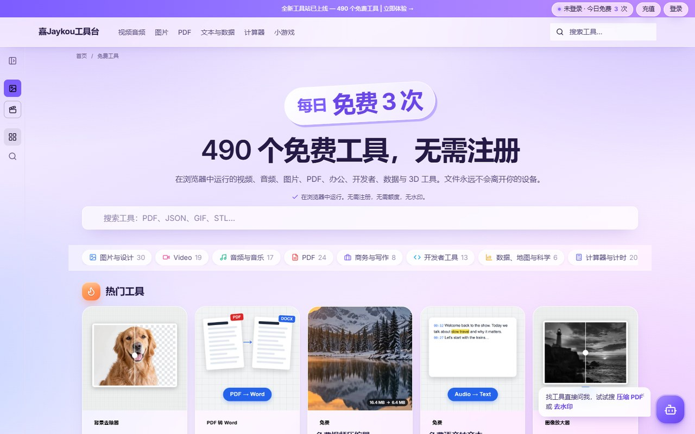
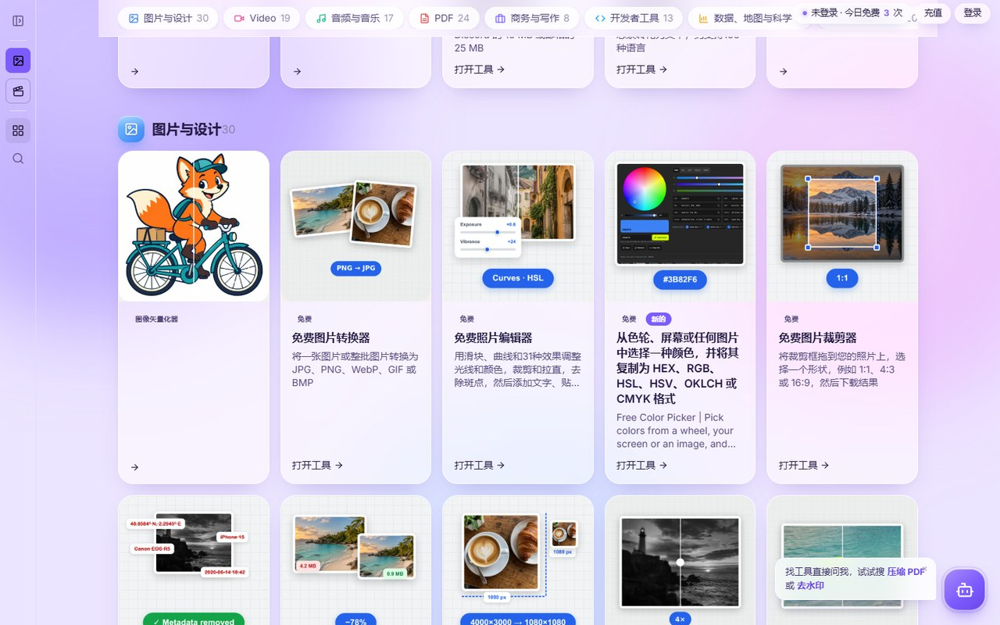
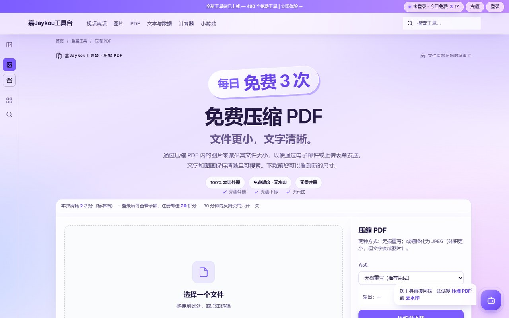
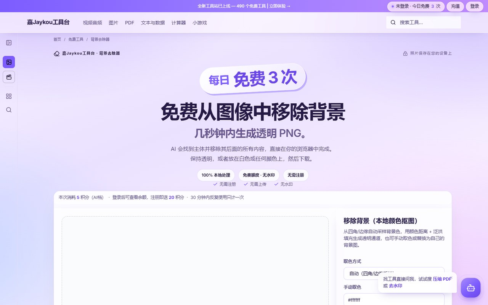

# 嘉Jaykou工具台

**490 个免费在线工具，全部在浏览器本地运行，无需注册，文件不上传服务器。**

在线公开版：**https://qq499797400-cpu.github.io/jaykou-tools-site/**

纯静态站点，没有任何后端 —— 拖进来就能用，关掉浏览器文件就留在你自己电脑里。
Windows 与 macOS 通用。

## 界面预览

| 首页 | 工具分类浏览 |
|---|---|
|  |  |

| 免费视频压缩（FFmpeg WASM） | 免费 PDF 压缩 | 图片一键去背景 |
|:---:|:---:|:---:|
|  |  |  |

## 为什么用它

- **隐私优先**：所有处理都在浏览器里完成（JavaScript + WebAssembly），文件从不经过服务器。
- **零门槛**：不用注册、不装软件、没有水印、没有强制付费墙。
- **真·本地多媒体**：视频转码、音频提取、图片批处理由 FFmpeg / WASM 引擎在本地跑，速度取决于你的机器。
- **即开即用**：纯 HTML/CSS/JS，无构建步骤、无 node_modules、无依赖安装，解压即用。
- **PWA 支持**：可安装到桌面或手机主屏，当独立应用使用。

## 490 个工具都在这里

| 分类 | 数量 | 代表工具 |
|---|---:|---|
| 图片 | 80 | 去背景、压缩、格式转换、放大、加水印、拼图 |
| 小游戏 | 63 | 2048、扫雷、贪吃蛇、纸牌、解谜 |
| 视频 | 59 | 压缩、裁剪、转 GIF、抽帧、30→60FPS 补帧、MP4 转 MP3 |
| PDF | 45 | 压缩、合并、拆分、转图片、加水印、OCR |
| 日常计算 | 45 | 贷款、汇率、日期、BMI、单位换算 |
| 开发 | 47 | JSON 格式化、正则测试、JWT 解码、Base64、Cron、SQL 格式化 |
| 3D 模型 | 29 | STL/OBJ/GLB/GLTF/STEP 互转与在线预览 |
| 数据 | 21 | CSV ↔ JSON ↔ Excel、JSON 转 SQL、表格清洗 |
| 模拟器 | 22 | 6502、PICO-8、Chip-8、NES 键盘映射 |
| 音频 | 24 | 剪辑、变调、去人声、波形可视化 |
| AI 工具 | 15 | 抠图、画质增强、风格化、智能填充 |
| 办公文档 | 17 | Word/Excel 转换、Markdown、幻灯片 |
| 二维码 | 5 | 生成、美化、批量、WiFi 二维码 |
| 手工设计 | 7 | 十字绣图纸、拼布图案、钻石画 |
| 设备 | 6 | 屏幕测试、键盘检测、手柄测试 |
| 图表绘制 | 3 | 流程图、思维导图 |

另有"热门"精选位，常用工具一键直达。

## 启动

### Windows

双击 `启动网站.bat`。

### macOS

双击 `启动网站.command`。第一次被拦下时：右键 → 「打开」→ 再点一次「打开」；
若提示 Permission denied，终端里执行一次：

```bash
chmod +x 启动网站.command
```

> **不要直接双击 `index.html`**：浏览器在 `file://` 下拒绝加载 WebAssembly，
> 视频压缩 / 格式转换 / 音频处理 / 3D 预览 / AI 类工具会全部失效。

启动后浏览器会自动打开 `http://localhost:8080/`，端口占用会自动顺延，停止按 `Ctrl+C`。

| 平台 | 依赖 | 说明 |
|---|---|---|
| Windows | 无 | 自带脚本优先用 Python，没有则退回系统组件 |
| macOS | python3（推荐）/ ruby / php | 脚本按此顺序自动探测 |

## 部署到公网

整个目录就是站点根目录，扔给任何静态托管都行：GitHub Pages、Vercel、Netlify、
腾讯云 COS、阿里云 OSS、Nginx。

上线前把 `sitemap.xml` 和 `robots.txt` 里的
`qq499797400-cpu.github.io/jaykou-tools-site` 换成自己的域名。
需要确认的只有一条：`.wasm` 文件要以 `application/wasm` 的 MIME 返回（主流托管默认正确）。

## 目录结构

```
嘉Jaykou工具台/
├─ index.html                 首页（工具导航 + 搜索）
├─ free-tools/                490 个工具页面，每页一个独立 HTML
├─ assets/
│  ├─ impl/                   自研引擎（ai/av/calc/game/gen/image/pdf/text/viewer3d）
│  ├─ vendor/                 33 MB，ffmpeg-core.wasm 等第三方引擎
│  ├─ media/                  454 张工具配图、图标、字体
│  ├─ credits.js              积分额度系统（前端记账）
│  └─ tools-index.js          工具索引（分类/搜索数据）
├─ screenshots/               本 README 使用的界面截图
├─ 启动网站.bat / .command     双平台启动入口
├─ serve.ps1 / serve_mac.py / serve_mac.rb   本地静态服务脚本
└─ third-party-licenses.html 第三方组件许可清单
```

## 技术栈

- 纯 HTML / CSS / 原生 JavaScript，零框架、零构建
- WebAssembly：FFmpeg（视频音频）、图片处理引擎
- three.js 生态（3D 预览与格式转换）
- 第三方组件及其许可见 `third-party-licenses.html`

## 已知限制

1. 积分账本存在浏览器本地 —— 换设备或清缓存会丢，重要额度建议记录在别处

## License

站点代码归 **嘉Jaykou工具台** 所有。`assets/vendor/` 内的第三方库遵循其各自的开源许可（详见 `third-party-licenses.html`）。

## 体积

1059 个文件，约 88 MB。最大文件 `assets/vendor/ffmpeg-core.wasm`（30.6 MB），
未触及 GitHub 的 100 MB 单文件限制，无需 Git LFS。
